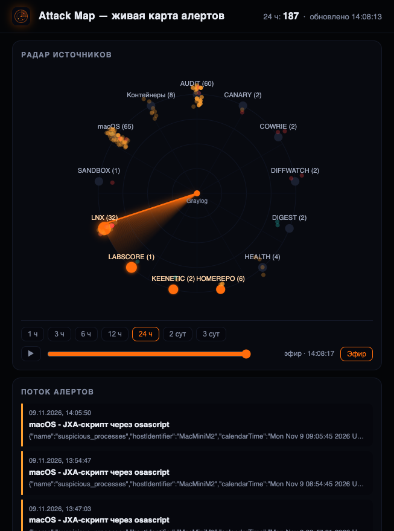
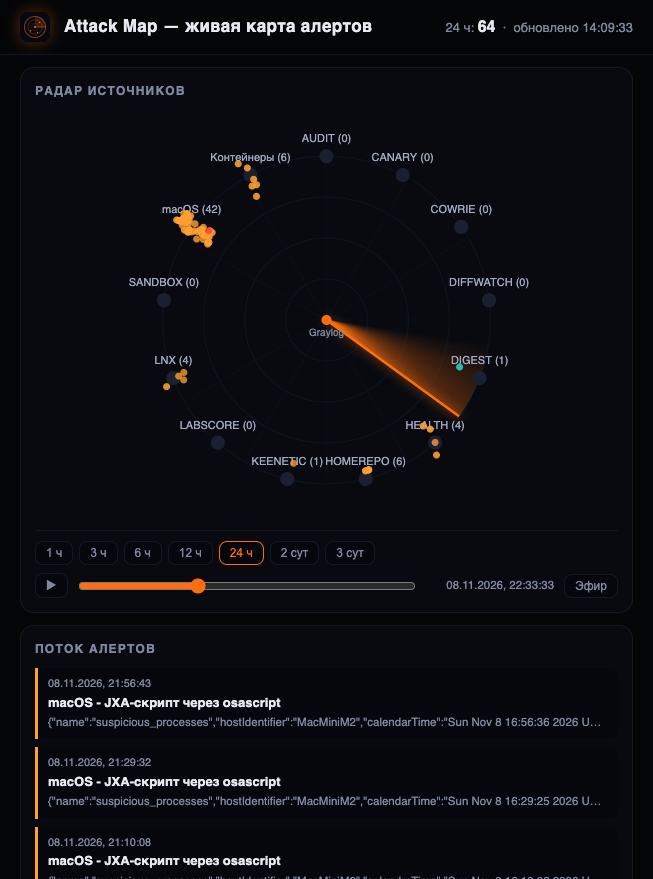

# Attack Map

Живая карта алертов Graylog — одна страница для дежурного экрана, скринкастов
и докладов. Обновление каждые 10 секунд.


## Что на странице

- **Поток алертов** — последние 60 событий, цветная рамка по приоритету
  (high/medium/low), деталь из исходного сообщения;
- **Радар источников** — узлы — платформы и свои инструменты
  (Windows, macOS, LNX, CANARY, COWRIE...), в центре Graylog. Луч сканирует
  круг по часовой стрелке: узел вспыхивает, когда луч его проходит; события —
  точки вокруг узлов в цвете приоритета, тускнеют по мере старения, новое
  событие даёт расходящееся кольцо;
- **Хронология** — диапазоны 1 ч / 3 ч / 6 ч / 12 ч / 24 ч / 2 сут / 3 сут,
  слайдер прокрутки окна и кнопка проигрывания: луч прокручивает период,
  и события вспыхивают по мере его прохода. Кнопка «Эфир» возвращает в
  живой режим;
- **Правая колонка** — счётчики по приоритетам, топ-10 правил и активность
  по источникам; в режиме истории пересчитываются на позицию слайдера.

| Эфир | Хронология |
|---|---|
|  |  |

Бэкенд — Python stdlib (`http.server`), ходит в Graylog REST
(`/api/events/search` с явным `timerange`), кеш 8 секунд.
Фронт — один HTML без зависимостей; на узких экранах колонки
складываются вертикально, радар уезжает наверх.

## Запуск (rootless podman, RED OS 8)

```bash
mkdir -p ~/attackmap
cp app.py index.html attackmap.svg Containerfile ~/attackmap/
printf 'GRAYLOG_USER=admin\nGRAYLOG_PASS=***\n' > ~/attackmap/attackmap.env  # не коммитить!
chmod 600 ~/attackmap/attackmap.env
cd ~/attackmap && podman build -t localhost/attackmap:latest .
cp attackmap.container ~/.config/containers/systemd/
systemctl --user daemon-reload
systemctl --user start attackmap.service
sudo firewall-cmd --permanent --add-port=8097/tcp && sudo firewall-cmd --add-port=8097/tcp
```

Страница: `http://<сервер>:8097/`.

## API

| Метод | Назначение |
|---|---|
| `GET /api/events?hours=N` | события за окно N часов (1..168), до 500, свежие первыми |
| `GET /api/overview` | legacy-сводка за 24 ч (совместимость) |
| `GET /favicon.svg` | логотип-радар |

## Грабли

- Из rootless-контейнера `https://graylog.apps.monitoring.test` недоступен
  (hairpin на LAN-адрес хоста не работает, SNI на host.containers.internal
  не совпадает) — ходим напрямую: `GRAYLOG_URL=http://host.containers.internal:9000`.
- Учётка Graylog задаётся через `GRAYLOG_USER`/`GRAYLOG_PASS` в quadlet'е —
  для боя заведите отдельного пользователя с ролью только на чтение событий.
- Без явного `timerange` в `events/search` Graylog возвращает неполные сутки —
  поэтому окно задаём всегда явно.

## Настройка

| ENV | Умолчание | Назначение |
|---|---|---|
| `GRAYLOG_URL` | `http://host.containers.internal:9000` | адрес API Graylog |
| `GRAYLOG_USER` / `GRAYLOG_PASS` | admin/admin | учётка API |
| `AM_PORT` | 8097 | порт страницы |
